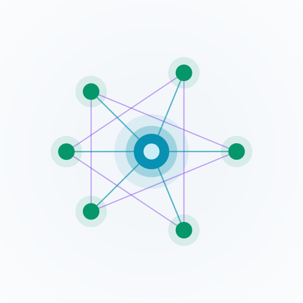
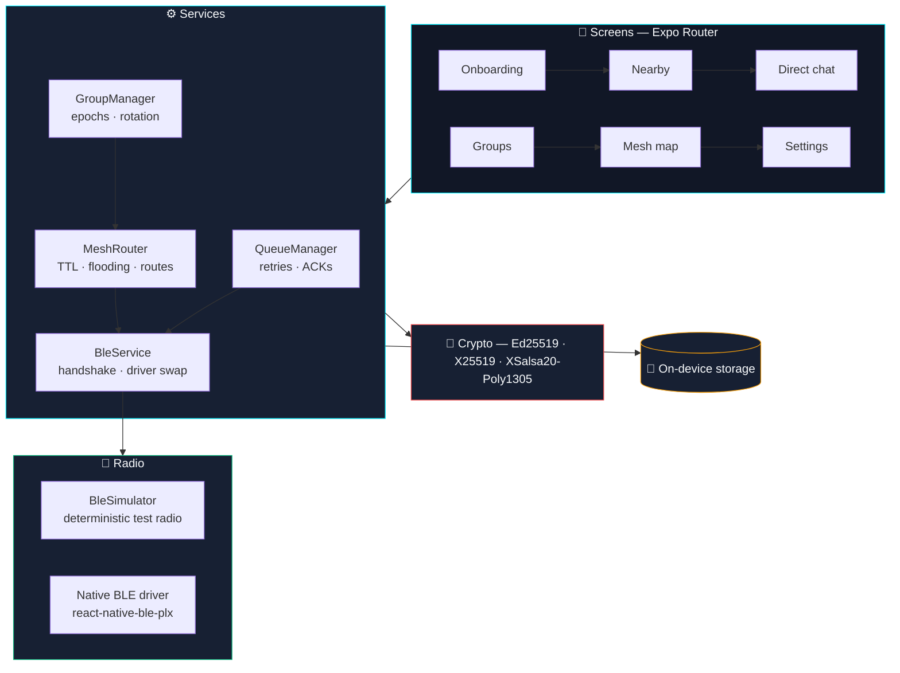

<div align="center">

<picture>
  <source media="(prefers-color-scheme: dark)" srcset="logo-dark.png">
  <source media="(prefers-color-scheme: light)" srcset="logo-light.png">
  
</picture>

# NearLink

[](https://github.com/anurag-panda-dev/NearLink/actions/workflows/ci.yml)
[](https://github.com/anurag-panda-dev/NearLink/actions/workflows/ci.yml)
[](https://github.com/anurag-panda-dev/NearLink/releases)
[](./LICENSE)
[](https://github.com/anurag-panda-dev/NearLink/discussions)
[](https://github.com/anurag-panda-dev/NearLink/stargazers)

**📡 Keep talking when the internet doesn't. NearLink is an offline-first, end-to-end
encrypted messenger that relays messages device-to-device over a Bluetooth mesh —
no servers, no accounts, no signal required.**

[📖 Setup Guide](./GUIDE.md) · [🧪 Run the Demo](#try-it-in-60-seconds) · [💬 Discussions](https://github.com/anurag-panda-dev/NearLink/discussions) · [🐛 Report a Bug](https://github.com/anurag-panda-dev/NearLink/issues)

</div>

---

## Why NearLink

When the cell tower dies — disaster zone, blackout, festival, tunnel, border, trail —
every other messenger goes quiet. NearLink doesn't.

It turns each phone into a **mesh node**. Devices form an ad-hoc Bluetooth network
and hand messages to each other until they reach their destination, even when no two
phones are in direct radio range.

|                              | **NearLink** | WhatsApp | Telegram | Signal |
| --------------------------- | :-----------: | :------: | :------: | :----: |
| Works with **zero internet** |       ✅       |    ❌    |    ❌    |   ❌   |
| **No central server**       |       ✅       |    ❌    |    ❌    |   ⚠️   |
| **No account or phone #**    |       ✅       |    ❌    |    ❌    |   ❌   |
| **End-to-end encrypted**     |       ✅       |    ✅    |    ✅    |   ✅   |
| **Multi-hop mesh relay**     |       ✅       |    ❌    |    ❌    |   ❌   |
| **Device-to-device only**    |       ✅       |    ❌    |    ❌    |   ❌   |
| **Works in airplane mode**   |       ✅       |    ❌    |    ❌    |   ❌   |
| **Open source**              |     ✅ MIT     |    ❌    |    ❌    |   ✅   |

> **Zero Cloud** — no analytics, no telemetry, no remote backend, no account system.
> Every key, contact, group and message stays on the device that created it.

---

## What you get

| 🔐 **Cryptography** | 📶 **Radio & mesh** | 📨 **Messaging** |
| :----------------: | :-----------------: | :---------------: |
| Ed25519 identity signatures | Plug-in BLE drivers | End-to-end encrypted DMs |
| X25519 key agreement | Live peer discovery | Decentralized group rooms |
| XSalsa20-Poly1305 AEAD | Signed handshakes | 256-bit group keys + epochs |
| 6-digit safety numbers | Multi-hop relay (TTL 5) | Delivery ACKs, not just sends |
| SHA-512 fingerprints | Loop prevention | Persistent offline retry queue |
| Key rotation on change | Duplicate suppression | Auto-flush on reconnect |
| QR identity & invites | Battery-aware relaying | Live mesh topology map |

### 🔐 Real cryptography, not hand-waving

- **Ed25519** signs every handshake and every mesh envelope.
- **X25519 + XSalsa20-Poly1305** seals one-to-one messages.
- **256-bit symmetric keys** encrypt group traffic, with epochs and rotation.
- **Safety numbers** give you a 6-digit code to compare out of band.
- Keys never leave the device, and the crypto layer is covered by tests.

### 🕸️ A mesh that actually routes

Each packet carries a TTL, a hop counter, a traversal path and a signature.
Nodes refuse to rebroadcast a packet they've already seen, drop packets whose
TTL ran out, and stop forwarding when your battery is low.

### 📶 A radio layer you can test

The BLE stack sits behind one interface. Out of the box it runs a deterministic
in-memory simulator, so you can exercise the full mesh in CI or in the browser.
Swap in `react-native-ble-plx` or `expo-bluetooth` for real hardware — no call
sites change.

---

## Try it in 60 seconds

You don't need two phones, a build server, or a network connection. Run the
demo and watch the real crypto and mesh code work end to end:

```bash
git clone https://github.com/anurag-panda-dev/NearLink.git
cd NearLink
npm install --legacy-peer-deps
npm run demo
```

```
[1/6] Device identity (Ed25519 + X25519, generated on-device)
  fingerprint            08:8E:B2:4D:DE:DF:AE:B1
  safety number          634731
  ✔ both sides derive the same 6-digit code (match)

[2/6] End-to-end encryption (XSalsa20-Poly1305)
  ciphertext             sWplRzEwUvkWh3fOH17EDEKpAeWdCsC4wgin9vMfz…
  ✔ round trip → "Meet me at the north tower in 5."
  ✔ tampered ciphertext rejected (AEAD tag mismatch)

[3/6] Signed handshake over the simulated BLE radio
  ✔ Ed25519 signature verified by the receiver

[4/6] Mesh envelope origination + radio transmission
  hopLimit / hopCount    5 / 0
  ✔ envelope signature valid → true
  ✔ payload crossed the radio intact → "meet at the north tower"

[5/6] Relay guards on a forwarding node
  ✔ TTL exhausted (hopLimit=1) → dropped
  ✔ loop prevention (node already in path) → not re-broadcast
  ✔ duplicate suppression → second copy dropped
  ✔ multi-hop relay completed: alice → bob → cara

[6/6] Group keys, wire framing & delivery ACKs
  ✔ group message round trip → "group hello"
  ✔ delivery ACK framed + parsed → msg-demo-001
```

That output comes from the same modules the app ships with — nothing is mocked.

---

## Install

Pick the path that matches what you want to do:

| I want to…                     | Command                                                              | Time   |
| ------------------------------ | -------------------------------------------------------------------- | ------ |
| See the UI right now           | `npm install --legacy-peer-deps && npm start` → scan the QR with Expo Go | ~2 min |
| Run on Android                  | `npm run android`                                                    | ~5 min |
| Run on iOS                      | `npm run ios`                                                        | ~5 min |
| Play in a browser (simulated)  | `npm run web`                                                        | ~1 min |
| Sideload a real APK             | `eas build -p android --profile preview`                             | ~10 min |
| Build from source               | `npx expo prebuild --platform android && cd android && ./gradlew assembleRelease` | ~15 min |

**Requirements:** Node.js 18+ (20 recommended), Android 8+ or iOS 13+ with
Bluetooth LE. Expo Go is fine for the UI; native BLE needs a development build.

📖 Full instructions, device pairing and multi-device mesh testing live in
**[GUIDE.md](./GUIDE.md)**.

---

## Quick start

**1. Start the dev server**

```bash
npm start
```

Press `w` for web, `a` for Android, `i` for iOS, or scan the QR code with Expo Go.

**2. Prove the stack is healthy**

```bash
npm test           # 22 tests across 5 suites
npm run typecheck  # strict TypeScript, no emit
```

**3. Go offline and try it**

Turn off Wi-Fi and mobile data on two devices, open NearLink on both, then:

- **Nearby → Scan** — you should see the other device with a live RSSI bar.
- **Pair**, then open the chat and send a message.
- Tap the **shield icon** to compare the 6-digit safety number on both screens.
- For a relay test, put a third device between the two — the message arrives with
  a **hop count** attached.

### Commands

| Command               | What it does                                    |
| --------------------- | ----------------------------------------------- |
| `npm start`           | Expo dev server                                 |
| `npm run android`     | Native Android build                             |
| `npm run ios`         | Native iOS build                                 |
| `npm run web`         | Browser preview with the simulated radio         |
| `npm test`            | Jest verification suite                          |
| `npm run test:coverage` | Coverage report                                |
| `npm run typecheck`   | `tsc --noEmit`, strict                           |
| `npm run demo`        | Runnable offline-mesh demo                       |
| `npm run assets`      | Regenerate the brand assets                      |

---

## How it works



### The mesh envelope

Every relayed packet is signed and self-describing:

```ts
interface MeshPacketEnvelope {
  messageId: string;      // unique dedup id
  senderId: string;
  destinationId: string;  // peer id | group id | '*' for broadcast
  groupId?: string;
  sequenceNumber: number;
  hopLimit: number;       // TTL, starts at 5
  hopCount: number;       // increments per hop
  expiry: number;         // packets expire after 24 h
  payload: string;        // encrypted JSON
  signature: string;      // Ed25519 over id + destination + payload + seq
  path: string[];         // node ids that forwarded this packet
}
```

### Relay rules

| Guard                | Rule                          | What happens                             |
| -------------------- | ----------------------------- | ---------------------------------------- |
| ⏱️ TTL                | `hopLimit <= 1`               | Packet dropped, counter incremented       |
| 🔁 Loop prevention    | node already in `path`        | Packet is never rebroadcast               |
| 🧬 Duplicate          | `messageId` already seen      | Second copy dropped (LRU + 1 h TTL)       |
| 🪫 Battery-aware      | battery is low                | Node stops forwarding, still receives     |
| 📦 Size guard         | payload over 64 KB            | Oversized packet dropped                  |
| ⌛ Expiry             | `now > expiry`                | Stale packet dropped                      |

### Cryptography reference

| Purpose                | Primitive                    | Implementation                   |
| ---------------------- | ---------------------------- | -------------------------------- |
| Identity signing       | Ed25519                      | `nacl.sign`                      |
| Key agreement          | X25519                       | `nacl.box`                      |
| 1:1 message encryption | XSalsa20-Poly1305 (AEAD)     | `nacl.box` / `nacl.box.open`    |
| Group encryption       | XSalsa20-Poly1305 + 256-bit  | `nacl.secretbox`                 |
| Fingerprints           | SHA-512 (truncated)          | `nacl.hash`                      |
| Safety numbers         | SHA-512 → 6 digits           | lexicographically sorted keys   |
| Nonces                 | 24-byte CSPRNG per message   | `nacl.randomBytes`               |

---

## The app

| Screen                | Route                | What it does                                                  |
| --------------------- | -------------------- | ------------------------------------------------------------- |
| 🧑 Onboarding         | `app/index.tsx`      | Privacy promise, display name, on-device keypair generation     |
| 📡 Nearby             | `app/nearby.tsx`     | Live BLE scan, RSSI bars, GATT pairing                         |
| 💬 Chats              | `app/chats.tsx`      | Conversation list, unread badges, delivery ticks               |
| 🗨️ Direct chat        | `app/chat/[id].tsx`  | E2EE messaging, safety-number modal, reactions                 |
| 👥 Groups             | `app/groups.tsx`     | Room list, member counts, unread previews                      |
| ➕ Create group       | `app/group/create.tsx` | Offline room with an auto-generated 256-bit key              |
| 🕸️ Group chat         | `app/group/[id].tsx` | Multi-recipient mesh chat, roster, QR invites, key rotation    |
| 🗺️ Mesh topology      | `app/mesh.tsx`       | Radar map, live routing table, test packets, battery saver      |
| ⚙️ Settings           | `app/settings.tsx`   | Fingerprints, QR sharing, relay opt-in, irreversible wipe      |

---

## Project layout

```
NearLink/
├── app/                    # Expo Router screens
├── src/
│   ├── services/
│   │   ├── ble/            # driver interface, simulator, handshake
│   │   ├── crypto/         # keys, cipher, QR payloads
│   │   ├── group/          # group creation, epochs, rotation
│   │   ├── mesh/           # router, deduplication cache
│   │   ├── message-queue/  # framing, retries, delivery ACKs
│   │   └── storage/        # on-device persistence boundary
│   ├── stores/             # Zustand slices
│   ├── theme/              # design tokens
│   └── types/              # shared contracts
├── tests/                  # 22 Jest tests
├── scripts/                # demo, asset generation, validation
├── assets/                 # icon, splash, favicon
└── .github/                # CI, issue and PR templates
```

### Stack

| Layer        | Technology                                        |
| ------------ | ------------------------------------------------- |
| Framework    | React Native `0.86.3` · Expo SDK `57` · React `19.2` |
| Navigation   | Expo Router `57` (file-based)                     |
| Crypto       | TweetNaCl `1.0.3`                                  |
| State        | Zustand `5`                                        |
| Validation   | Zod `3`                                            |
| UI           | `lucide-react-native` · `react-native-svg`         |
| Storage      | `expo-secure-store` · on-device `StorageInterface` |
| Testing      | Jest `29` · ts-jest · GitHub Actions               |
| Build        | EAS Build · local Gradle                            |

---

## FAQ

**Does it really work without internet?**
Yes. Once the app is installed, nothing it does touches the network. Turn on
airplane mode and it keeps working.

**Do I need an account?**
No. There's no sign-up, no phone number, no email, no server. Your identity is a
keypair generated on your device.

**How do I know I'm talking to the right person?**
Compare the 6-digit safety number in person, or scan the QR code. It works like
Signal's safety numbers.

**How far does it reach?**
Bluetooth LE gives you roughly 30–100 m per hop. The mesh extends that — with
relay nodes switched on, two phones can talk across a building or a campus.

**Does my phone drain its battery relaying?**
You opt in to relaying, and the app stops forwarding automatically when the
battery is low. There's a live toggle in Settings.

**Is the crypto audited?**
Not yet. It uses well-known primitives (Ed25519, X25519, XSalsa20-Poly1305) via
TweetNaCl, but please report anything you find to
**[SECURITY.md](./SECURITY.md)**.

**Can I use it with regular people?**
Yes — anyone running the same build can pair with you. There's no closed network
to join.

---

## Contributing

Contributions are welcome — from developers, cryptographers and designers.

```bash
git clone https://github.com/anurag-panda-dev/NearLink.git
cd NearLink
npm install --legacy-peer-deps
npm test && npm run typecheck
```

Three rules keep the project honest:

- ☁️ **Zero Cloud** — no analytics, no remote backends, no centralized services.
- 🔐 **Audited primitives** — Ed25519, X25519 and XSalsa20-Poly1305 only.
- 🧪 **Test evidence** — routing, state and crypto changes ship with tests.

📖 Read **[CONTRIBUTING.md](./CONTRIBUTING.md)**. Questions? Start a
[discussion](https://github.com/anurag-panda-dev/NearLink/discussions).

---

## License

MIT © 2026 NearLink Contributors — see **[LICENSE](./LICENSE)**.

---

<div align="center">

### ⭐ If communication should work without a signal, give NearLink a star.

<sub>
<a href="#-why-nearlink">Why</a> ·
<a href="#-try-it-in-60-seconds">Demo</a> ·
<a href="./GUIDE.md">Guide</a> ·
<a href="./CONTRIBUTING.md">Contribute</a> ·
<a href="./SECURITY.md">Security</a>
</sub>

</div>
