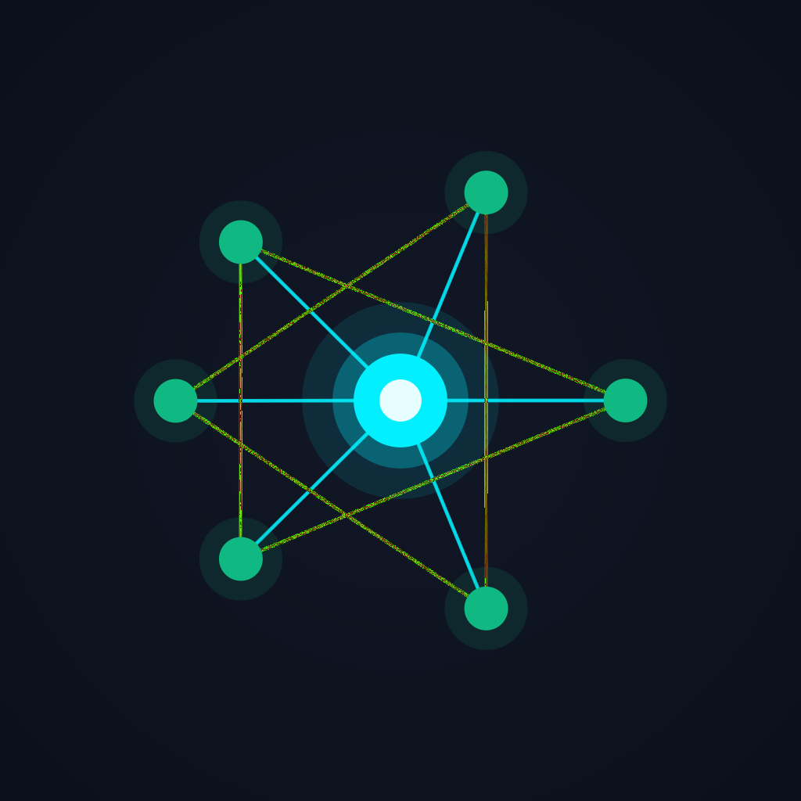
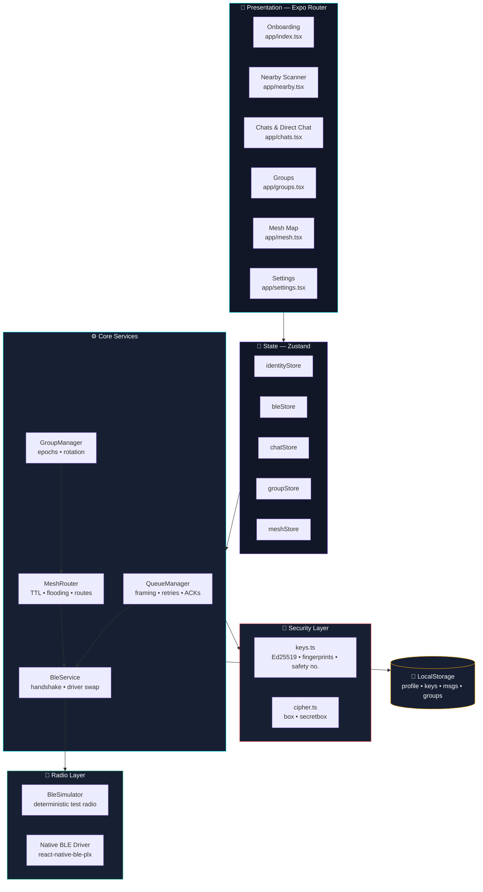
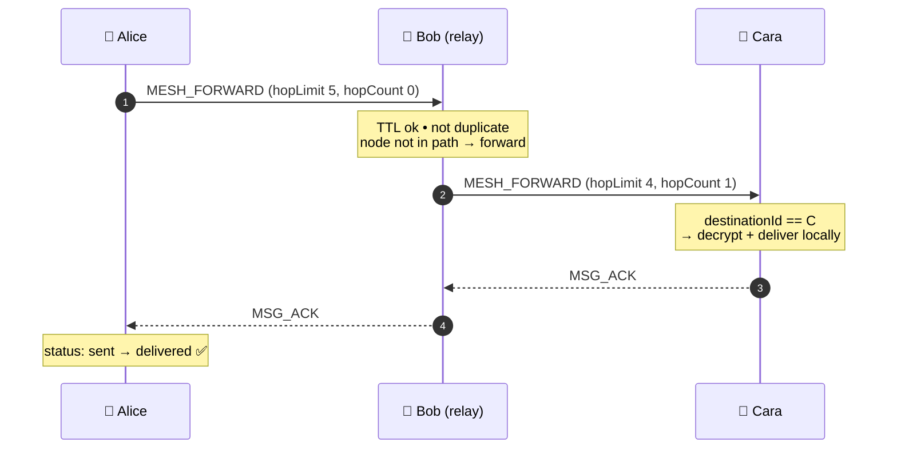
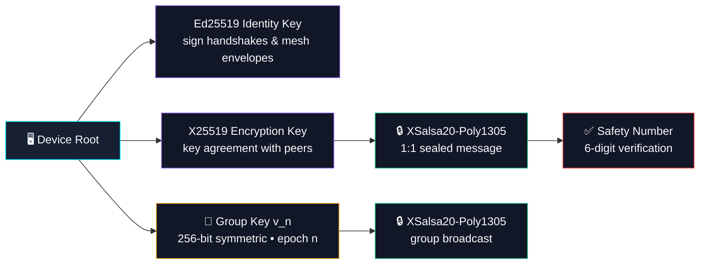
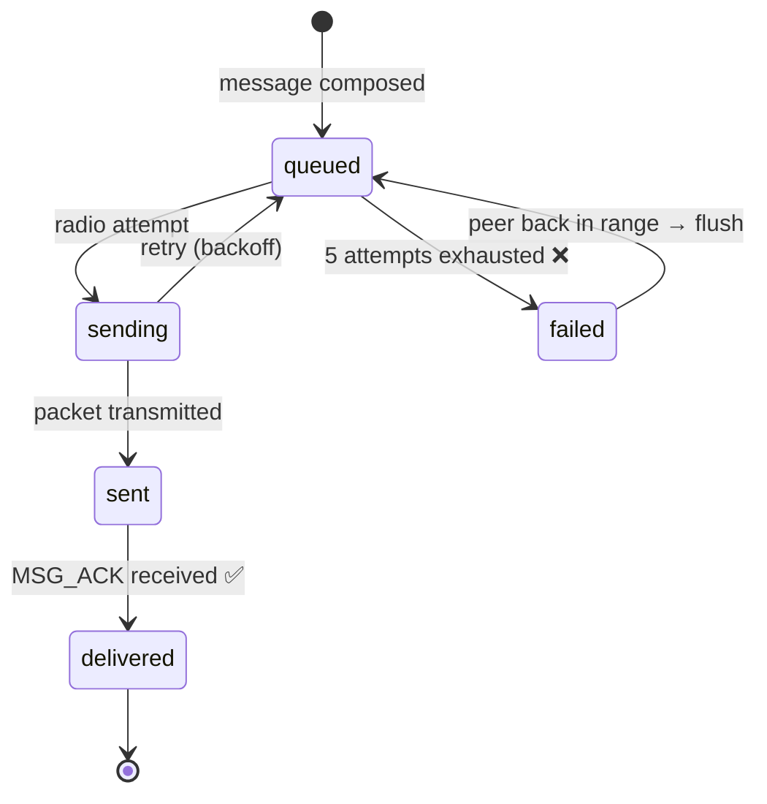

<!--
  ┌──────────────────────────────────────────────────────────────┐
  │  NearLink — Serverless Offline BLE & Mesh Messenger           │
  │  Tip: the slug `anurag-panda-dev/NearLink` is used in every  │
  │  badge & link below. Search & replace it if your repo path   │
  │  differs.                                                     │
  └──────────────────────────────────────────────────────────────┘
-->

<div align="center">

<p align="center">
  
</p>

# 📡 NearLink

### Serverless · Offline-First · End-to-End Encrypted · BLE Mesh

<p align="center">
  
</p>

<p align="center">
  <strong>NearLink</strong> is a decentralized offline messenger built with
  <strong>React Native</strong> &amp; <strong>Expo</strong>. Nearby phones discover each other over
  <strong>Bluetooth Low Energy</strong>, verify identities with <strong>Ed25519</strong> signatures, and
  exchange <strong>end-to-end encrypted</strong> messages — relayed across a
  <strong>multi-hop BLE mesh</strong> with no cellular signal, no SIM, no server, no internet.
</p>

<p align="center">
  <a href="#-quick-start"></a>
  <a href="#-architecture"></a>
  <a href="#-the-mesh-protocol"></a>
  <a href="#-cryptography"></a>
</p>

</div>

---

## 🏅 Badges

<div align="center">

[](https://reactnative.dev)
[](https://expo.dev)
[](https://www.typescriptlang.org)
[](https://docs.expo.dev/router/introduction/)
[](./LICENSE)
[](https://github.com/anurag-panda-dev/NearLink/actions/workflows/ci.yml)

[](https://github.com/anurag-panda-dev/NearLink/actions/workflows/ci.yml)
[](https://github.com/anurag-panda-dev/NearLink/actions/workflows/ci.yml)
[](https://github.com/anurag-panda-dev/NearLink/stargazers)
[](https://github.com/anurag-panda-dev/NearLink/network/members)
[](https://github.com/anurag-panda-dev/NearLink/issues)
[](https://github.com/anurag-panda-dev/NearLink/pulls)
[](https://github.com/anurag-panda-dev/NearLink/commits/main)
[](https://github.com/anurag-panda-dev/NearLink/graphs/contributors)

[](https://github.com/anurag-panda-dev/NearLink)
[](https://github.com/anurag-panda-dev/NearLink)
[](https://github.com/anurag-panda-dev/NearLink)
[](./CONTRIBUTING.md)
[](https://github.com/anurag-panda-dev/NearLink)

</div>

---

## 📑 Table of Contents

<details>
<summary><b>Click to expand</b></summary>

- [💡 Why NearLink](#-why-nearlink)
- [🚀 Quick Start](#-quick-start)
- [✨ Feature Matrix](#-feature-matrix)
- [🧬 Architecture](#-architecture)
- [🌐 The Mesh Protocol](#-the-mesh-protocol)
- [🔐 Cryptography](#-cryptography)
- [📬 Reliable Delivery](#-reliable-delivery)
- [📱 App Tour](#-app-tour)
- [🧪 Testing & CI](#-testing--ci)
- [📂 Project Structure](#-project-structure)
- [🧰 Tech Stack](#-tech-stack)
- [🧭 Roadmap](#-roadmap)
- [🤝 Contributing](#-contributing)
- [🔒 Security](#-security)
- [📄 License](#-license)

</details>

---

## 💡 Why NearLink

When the network dies — disaster zone, blackout, concert, campus outage, border crossing, mountain trail — normal messengers go silent. **NearLink keeps talking.**

It turns every phone into a **mesh node**. Devices form an ad-hoc BLE network, and messages hop device-to-device until they reach their destination — even when no two peers are in direct radio range.

| | **NearLink** | WhatsApp | Telegram | Signal |
|---|:---:|:---:|:---:|:---:|
| Works with **zero internet** | ✅ | ❌ | ❌ | ❌ |
| **No central server** | ✅ | ❌ | ❌ | ⚠️ |
| **No account / phone number** | ✅ | ❌ | ❌ | ❌ |
| **End-to-end encrypted** | ✅ | ✅ | ✅ | ✅ |
| **Multi-hop mesh relay** | ✅ | ❌ | ❌ | ❌ |
| **Device-to-device only** | ✅ | ❌ | ❌ | ❌ |
| **Open source** | ✅ MIT | ❌ | ❌ | ✅ |
| **Works in airplane mode** | ✅ | ❌ | ❌ | ❌ |

> **Zero Cloud Invariant** — NearLink contains no analytics SDK, no remote backend, no telemetry, no account system. Every key, contact, group, and message lives only on your device.

---

## 🚀 Quick Start

### Prerequisites

| Requirement | Version |
|---|---|
| **Node.js** | v18+ (v20 recommended) |
| **Package Manager** | npm / yarn |
| **Device** | Android 8+ / iOS 13+ with Bluetooth LE |
| **Optional** | Expo Go (UI preview) · Android Studio / Xcode (native BLE builds) |

### 1️⃣ Install

```bash
git clone https://github.com/anurag-panda-dev/NearLink.git
cd NearLink
npm install --legacy-peer-deps
```

### 2️⃣ Run

```bash
npm start          # Expo dev server (press w = web, a = android, i = ios)
npm run android    # native Android build
npm run ios        # native iOS build
npm run web        # browser preview via BLE simulator
```

### 3️⃣ Verify

```bash
npm test           # 22 unit tests across 5 suites
npm run typecheck  # strict TypeScript check
```

### 4️⃣ Build a distributable APK

```bash
npm install -g eas-cli
eas login
eas build -p android --profile preview    # → downloadable .apk + QR code
```

> 📖 Full walkthrough — device setup, local Gradle builds, multi-device BLE testing and mesh relay testing — lives in **[GUIDE.md](./GUIDE.md)**.

---

## ✨ Feature Matrix

<div align="center">

| 🔒 **Cryptography** | 📶 **Radio & Mesh** | 📨 **Messaging** |
|:---:|:---:|:---:|
| Ed25519 identity signatures | Dual-mode radio abstraction | End-to-end encrypted DMs |
| X25519 key agreement | Live BLE peer discovery | Decentralized group rooms |
| XSalsa20-Poly1305 AEAD | Signed handshake + version negotiation | 256-bit group keys w/ epochs |
| Safety numbers (6-digit) | Multi-hop relay (TTL = 5) | Application-level delivery ACKs |
| SHA-512 fingerprints | Loop prevention via path vector | Persistent offline retry queue |
| Key rotation on membership change | LRU + TTL dedup cache | Auto-flush on reconnect |
| QR identity & invite codes | Battery-aware relay throttling | Duplicate suppression |

</div>

### 🚫 Zero Cloud, Serverless & Offline First
- No phone numbers, no email, no accounts, no cloud infrastructure.
- Profiles, keypairs, contact rosters, groups and message history live **strictly on-device**.
- Every byte travels radio-to-radio — no DNS, no TLS termination, no middlebox.

### 🧬 Cryptographic Engine (E2EE)
- **Identity keypairs** — Ed25519 signing + X25519 Diffie–Hellman, generated via TweetNaCl.
- **One-to-one messaging** — authenticated public-key encryption (`nacl.box`).
- **Decentralized groups** — 256-bit symmetric keys with epoch increments and rotation.
- **Safety numbers** — lexicographically derived 6-digit codes for out-of-band verification.
- **Mesh envelopes** — every forwarded packet is Ed25519-signed.

### 📶 BLE Abstraction & Dual-Mode Radio
- Pluggable `BleManagerInterface` driver — ships with a deterministic in-memory **`BleSimulator`** for tests, CI and browser preview.
- Native drivers (`react-native-ble-plx`, `expo-bluetooth`) drop in via `BleService.setManager()` — no call-site changes.
- Signed handshake with protocol version negotiation and signature validation on every peer.

### 📨 Reliable Message Queuing & Delivery ACKs
- Messages are marked `delivered` **only on recipient acknowledgement** — never on radio transmission.
- Persistent offline queue with exponential backoff, 5-attempt ceiling, and auto-flush when peers return.
- Deterministic duplicate suppression across queue, chat store and mesh layers.

### 🔗 Multi-Hop BLE Mesh Relay
- Signed **mesh packet envelope**: `messageId`, `senderId`, `destinationId`, `groupId`, `sequenceNumber`, `hopLimit`, `hopCount`, `expiry`, `signature`, `path`.
- **Loop prevention** — path vector tracking rejects packets that revisit a node.
- **Duplicate suppression** — LRU + TTL-bounded dedup cache (2 000 entries / 1 h).
- **Battery-aware relaying** — forwarding throttled automatically when the battery is low.
- **Live diagnostics** — interactive topology map, routing tables, and packet counters.

---

## 🧬 Architecture



### Layer by Layer

| Layer | Module | Responsibility |
|---|---|---|
| 🎨 **Presentation** | `app/` | Expo Router screens, dark cyberpunk theme, `lucide-react-native` icons |
| 🧠 **State** | `src/stores/` | Zustand slices for identity, BLE, chat, groups, mesh |
| ⚙️ **Core** | `src/services/` | Queueing, group management, mesh routing, BLE orchestration |
| 📶 **Radio** | `src/services/ble/` | Driver interface, simulator, native driver seam |
| 🔐 **Security** | `src/services/crypto/` | Key generation, AEAD encryption, signing, QR payloads |
| 💾 **Storage** | `src/services/storage/` | On-device persistence boundary (`StorageInterface`) |

---

## 🔗 The Mesh Protocol

### Packet envelope

```ts
interface MeshPacketEnvelope {
  messageId: string;      // unique dedup id
  senderId: string;
  senderName: string;
  destinationId: string;  // peer id | group id | '*' for broadcast
  groupId?: string;
  sequenceNumber: number;
  hopLimit: number;       // TTL, starts at 5
  hopCount: number;       // increments per hop
  expiry: number;         // unix ms — packets expire after 24 h
  payload: string;        // encrypted JSON
  signature: string;      // Ed25519 over id+destination+payload+seq
  path: string[];         // node ids that forwarded this packet
}
```

### Relay sequence



### Flooding rules

| Guard | Rule | Behaviour |
|---|---|---|
| ⏱️ **TTL** | `hopLimit ≤ 1` | Packet dropped, counted as `totalPacketsDroppedTtl` |
| 🔁 **Loop prevention** | `path.includes(localNodeId)` | Packet dropped — never re-broadcast |
| 🧬 **Duplicate suppression** | LRU 2 000 entries / 1 h TTL | Second copy dropped + counted |
| 🪫 **Battery-aware relay** | `batteryLow === true` | Node stops forwarding (still receives) |
| 📦 **Size guard** | `payload > 64 KB` | Oversized packet dropped |
| ⌛ **Expiry** | `now > expiry` | Stale packet dropped |

---

## 🔐 Cryptography

Built on **[TweetNaCl](https://tweetnacl.js.org/)** — a minimal, audited pure-JS port of NaCl.

| Purpose | Primitive | Implementation |
|---|---|---|
| Identity signing | **Ed25519** | `nacl.sign.keyPair()` · `nacl.sign.detached` |
| Key agreement | **X25519** | `nacl.box.keyPair()` |
| 1:1 message encryption | **XSalsa20-Poly1305** (AEAD) | `nacl.box` / `nacl.box.open` |
| Group message encryption | **XSalsa20-Poly1305** + 256-bit key | `nacl.secretbox` / `nacl.secretbox.open` |
| Fingerprints | **SHA-512** (truncated) | `nacl.hash` → `A1:B2:C3:…` |
| Safety numbers | **SHA-512** → 6 digits | lexicographically sorted key pair |
| Nonces | 24-byte CSPRNG | `nacl.randomBytes` per message |
| QR payloads | `nearlink:` URI + Base64 | `src/services/crypto/qr.ts` |

### Key hierarchy



---

## 📬 Reliable Delivery



- **ACK-based, not TX-based.** A blue tick means *the radio sent it*. A double tick means *the recipient confirmed it*.
- **Persistent queue.** Undelivered packets survive app restarts and are retried every 3 s (4 s since last attempt).
- **Auto-flush.** When a peer re-enters radio proximity, the queue for that peer is drained instantly.
- **Duplicate suppression.** `processedMessageIds` guarantees a message renders exactly once.

---

## 📱 App Tour

| Screen | Route | Highlights |
|---|---|---|
| 🧑 **Onboarding** | `app/index.tsx` | Privacy promises, display name, on-device keypair generation, permission rationale |
| 📡 **Nearby Scanner** | `app/nearby.tsx` | Live BLE scan, peer cards with live RSSI bars, GATT pairing |
| 💬 **Chats** | `app/chats.tsx` | Searchable conversation list, unread badges, delivery ticks, online indicators |
| 🗨️ **Direct Chat** | `app/chat/[id].tsx` | E2EE messaging, safety-number modal, reactions, status timeline |
| 👥 **Groups** | `app/groups.tsx` | Room list, member counters, unread previews |
| ➕ **Create Group** | `app/group/create.tsx` | Offline room creation with auto-generated 256-bit key |
| 🕸️ **Group Chat** | `app/group/[id].tsx` | Multi-recipient mesh chat, member roster, QR invites, key rotation |
| 🗺️ **Mesh Topology** | `app/mesh.tsx` | Interactive radar map, live routing table, test packets, battery saver |
| ⚙️ **Settings** | `app/settings.tsx` | Identity, key fingerprints, QR sharing, discoverable/relay toggles, data wipe |

### 🎨 Design language

Dark cyberpunk palette defined in `src/theme/colors.ts`:

```ts
background:     '#080C15'   // near-black base
surface:        '#111726'
primary:        '#00F0FF'   // cyberpunk BLE cyan
success:        '#10B981'   // verified / delivered emerald
purple:         '#8B5CF6'   // mesh relay violet
```

---

## 🧪 Testing & CI

```bash
npm test              # Jest + ts-jest — 22 tests, 5 suites
npm run test:coverage # coverage report
npm run typecheck     # tsc --noEmit (strict)
```

| Suite | Covers | Tests |
|---|---|:---:|
| 🔐 `crypto.test.ts` | Keypairs, fingerprints, safety numbers, signing, AEAD, group keys, QR | 7 |
| 🕸️ `mesh-routing.test.ts` | Envelope origination, loop prevention, TTL drop, dedup, battery policy | 5 |
| 👥 `group-messaging.test.ts` | Group creation, roster, encrypted send, key rotation + epoch | 4 |
| 📨 `message-queue.test.ts` | Envelope framing, ACK framing, duplicate suppression, delivery ACK | 4 |
| 📶 `ble-simulator.test.ts` | Peer discovery, GATT connect, packet transmission | 2 |

**CI pipeline** — `.github/workflows/ci.yml` runs typecheck + Jest on every push and PR to `main` (Node 20, npm cache enabled).

<details>
<summary><b>🧪 Example test run</b></summary>

```bash
$ npm test

PASS  tests/crypto.test.ts
PASS  tests/mesh-routing.test.ts
PASS  tests/group-messaging.test.ts
PASS  tests/message-queue.test.ts
PASS  tests/ble-simulator.test.ts

Test Suites: 5 passed, 5 total
Tests:       22 passed, 22 total
Snapshots:   0 total
```

</details>

---

## 📂 Project Structure

```
NearLink/
├── app/                        # 📱 Expo Router screens
│   ├── index.tsx               #    Onboarding
│   ├── nearby.tsx              #    BLE peer scanner
│   ├── chats.tsx               #    Conversation list
│   ├── chat/[id].tsx           #    Direct chat
│   ├── groups.tsx              #    Group list
│   ├── group/create.tsx        #    Create group
│   ├── group/[id].tsx          #    Group chat
│   ├── mesh.tsx                #    Topology & diagnostics
│   ├── settings.tsx            #    Identity & privacy
│   └── _layout.tsx             #    Root stack
│
├── src/
│   ├── components/             # 🧩 MeshTopologyMap, MessageBubble, PeerCard…
│   ├── services/
│   │   ├── ble/                # 📶 BleService, BleSimulator, driver interface
│   │   ├── crypto/             # 🔐 keys.ts, cipher.ts, qr.ts
│   │   ├── group/              # 👥 GroupManager
│   │   ├── mesh/               # 🕸️ MeshRouter, DeduplicationCache
│   │   ├── message-queue/      # 📨 QueueManager, Framing
│   │   └── storage/            # 💾 LocalStorage, StorageInterface
│   ├── stores/                 # 🧠 Zustand slices (identity/ble/chat/group/mesh)
│   ├── theme/                  # 🎨 Design tokens
│   └── types/                  # 📐 Shared TypeScript contracts
│
├── tests/                      # 🧪 Jest suites (22 tests)
├── assets/                     # 🖼️ Brand assets (icon, splash, favicon) — `npm run assets`
├── scripts/                    # 🛠️ Asset generation & validation tooling
├── .github/                    # ⚙️ CI workflow, issue + PR templates
├── app.json · eas.json         # Expo + EAS Build config
├── GUIDE.md                    # 📖 Build & device testing guide
├── CONTRIBUTING.md             # 🤝 Contribution guide
├── SECURITY.md                 # 🛡️ Disclosure policy
└── CODE_OF_CONDUCT.md          # 📜 Contributor Covenant 2.1
```

---

## 🧰 Tech Stack

| Layer | Technology |
|---|---|
| 📱 **Framework** | React Native `0.86.3` · Expo SDK `57` · React `19.2` |
| 🧭 **Navigation** | Expo Router `57` (file-based, typed routes) |
| 🔐 **Cryptography** | TweetNaCl `1.0.3` + `tweetnacl-util` |
| 🧠 **State** | Zustand `5` |
| ✅ **Validation** | Zod `3` |
| 🎨 **UI** | `lucide-react-native` · `react-native-svg` · `expo-status-bar` |
| 💾 **Storage** | `StorageInterface` boundary · `expo-secure-store` & `expo-crypto` for key material |
| 🧪 **Testing** | Jest `29` · ts-jest · GitHub Actions |
| 📦 **Build** | EAS Build (APK + App Bundle) · local Gradle |
| 📄 **License** | MIT |

---

## 🧭 Roadmap

- [x] 🔐 E2EE 1:1 messaging, decentralized groups, key rotation
- [x] 🕸️ Multi-hop BLE mesh with TTL, loop prevention & dedup
- [x] 📨 Reliable delivery queue with ACKs & offline retry
- [x] 🧪 22-test verification suite + CI
- [x] 🗺️ Live mesh topology & routing diagnostics
- [ ] 📶 Native BLE driver (`react-native-ble-plx` / `expo-bluetooth`) behind `BleManagerInterface`
- [ ] 💾 Durable on-device persistence via `expo-secure-store` + SQLite
- [ ] 📷 QR scan-to-verify with camera-based safety-number confirmation
- [ ] 🔊 Voice notes & file transfer over chunked BLE frames
- [ ] 🕸️ Zigbee / Thread / LoRa transport adapters
- [ ] 🌍 Multi-language (i18n) + RTL support
- [ ] 📲 Background BLE relay service (Android foreground service)

---

## 🤝 Contributing

Contributions are **welcome** — from developers, cryptographers, and designers.

1. 🍴 **Fork & clone** the repository
2. 🌱 **Create a branch** — `feature/mesh-packet-compression`
3. 🧪 **Verify locally** — `npm test && npm run typecheck`
4. 📝 **Commit** using [Conventional Commits](https://www.conventionalcommits.org/)
5. 🔁 **Open a Pull Request** with test evidence

**Architectural principles we don't break:**
- ☁️ **Zero Cloud** — no analytics, no remote backends, no centralized services.
- 🔐 **Audited crypto** — Ed25519, X25519, XSalsa20-Poly1305 only.
- 🧪 **Test evidence** — routing, state and crypto changes ship with tests.

📖 Read the full **[CONTRIBUTING.md](./CONTRIBUTING.md)** · 💬 Join the discussion in **[Issues](https://github.com/anurag-panda-dev/NearLink/issues)**.

---

## 🔒 Security

NearLink handles keys and messages that never leave the device — but please report vulnerabilities responsibly.

| | |
|---|---|
| 📬 **Report** | File a confidential advisory via GitHub Security Advisories, or email `security@nearlink.local` |
| ⏱️ **Response** | Initial triage within 72 hours |
| 📄 **Policy** | Full disclosure policy in **[SECURITY.md](./SECURITY.md)** |

> 🧪 The crypto layer is **not yet independently audited**. Use at your own risk and please report any issues you find.

---

## 📄 License

Released under the **MIT License**.

```
MIT © 2026 NearLink Contributors
```

See **[LICENSE](./LICENSE)** for the full text.

---

<div align="center">

### 💬 Built for the moments the internet isn't there.

<sub>Made with ❤️ by the NearLink community · <a href="https://github.com/anurag-panda-dev/NearLink/issues">Report an issue</a> · <a href="./CONTRIBUTING.md">Contribute</a></sub>

**⭐ Star this repo if you believe communication should work without a signal.**

</div>
